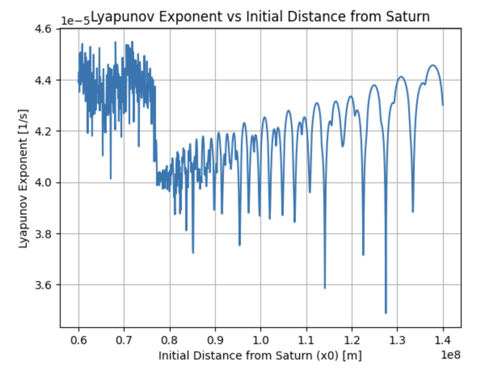
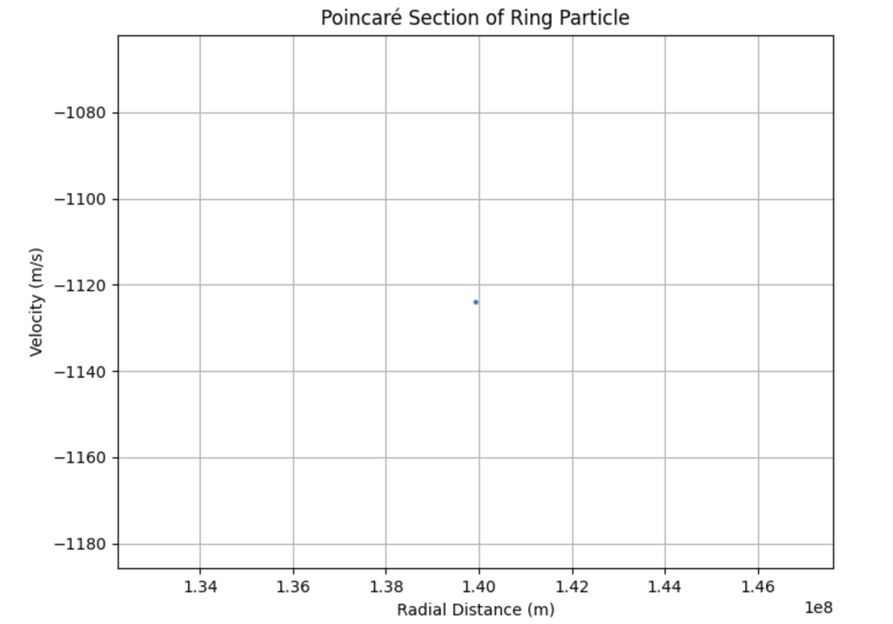
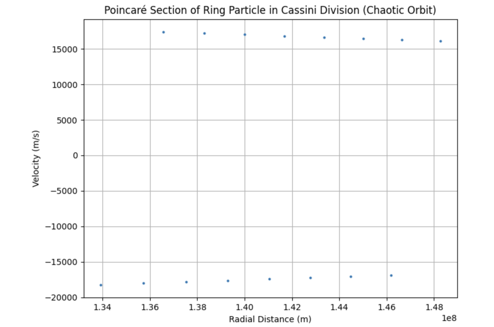
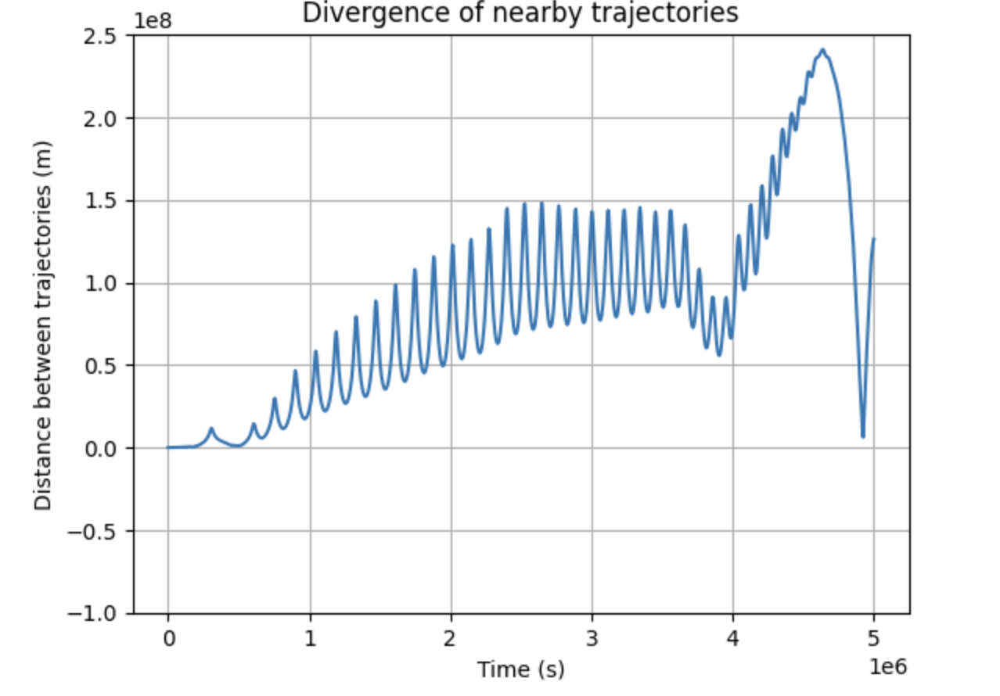
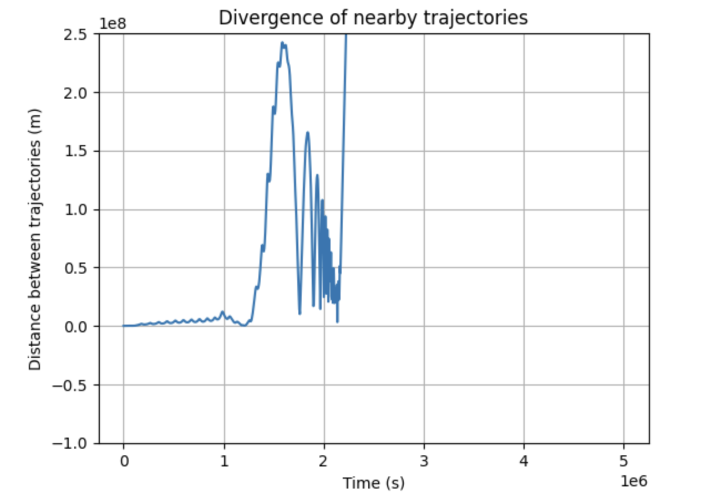

# Chaos and the Gaps in Saturn's Rings

Original Year 1 University project; code archived and not maintained 


A numerical study of why Saturn's rings have gaps. Ring particles are modelled as test particles in the **Saturn–Mimas three-body system**. For each starting distance from Saturn, the simulation measures how chaotic the particle's orbit is, using **Poincaré sections** and **Lyapunov exponents**. Peaks in the Lyapunov exponent fall at the positions of the major observed gaps, including the **Cassini Division**, which is caused by orbital resonance with Mimas.

This was my Year 1 independent essay at the University of Birmingham (March 2025), written in LaTeX with simulations in Python.

**Full report (9 pages):** [Saturn Rings Essay](https://github.com/Ruazokyrtap/Saturn-RIngs-Simulation/blob/main/Saturn_rings_essay.pdf)



*Lyapunov exponent λ as a function of a particle's initial distance from Saturn (0.6–1.4 × 10⁸ m). Troughs correspond to more stable orbits (rings), and peaks correspond to unstable orbits (gaps).*

---

## The question

The motion of three gravitating bodies has no general analytical solution, and it is usually chaotic. Every particle in Saturn's rings is affected by both Saturn and its moons, so in that sense the whole ring system is chaotic. The rings still have sharp, persistent structure. The aim of this project was to show that the *degree* of chaos varies with distance from Saturn, and that the most unstable distances match the observed gaps.

## Method

**Model.** The particle is a body of negligible mass moving under Newtonian gravity from Saturn and Mimas (a restricted three-body problem). The equations of motion were integrated numerically in Python (NumPy, Matplotlib) with a fixed time step of 100 s.

**Diagnostics.**
- **Poincaré sections:** the particle's radial position and velocity are recorded each time it crosses the plane θ = 0. A single repeated point indicates a periodic, stable orbit, and a spread of points indicates an unstable one.
- **Divergence of nearby trajectories:** two particles start a tiny distance apart, and the separation between them is tracked over time.
- **Lyapunov exponent:** λ is the exponential rate at which nearby trajectories separate, δ(t) ≈ δ₀ e^{λt}. It was computed for starting distances across the full ring system and compared with an image of the rings.

## Results

| | A ring (r = 1.32 × 10⁸ m) | Cassini Division (r = 1.20 × 10⁸ m) |
|---|---|---|
| **Poincaré section** |  |  |
| | A single point: the orbit repeats, so it is stable | Points spread over a range of radii: the orbit is not periodic |
| **Trajectory divergence** |  |  |
| | Trajectories stay close for ~4 × 10⁶ s before diverging | Resonant "humps" from Mimas's periodic pull; full divergence ~3 × 10⁶ s earlier |

**The Cassini Division is caused by resonance.** A particle at this distance lines up with Mimas at the same point in every orbit. Each pass gives it a small extra pull, and these repeated kicks build up until the particle is ejected. The "humps" in the divergence plot show this happening.

**The Lyapunov scan matches the observed structure** to within about ±0.05 × 10⁸ m:
- the extent of the rings (≈ 0.75–1.34 × 10⁸ m) and of the A ring (≈ 1.22–1.34 × 10⁸ m)
- the Cassini Division (≈ 1.17–1.20 × 10⁸ m), with no stable troughs
- the Maxwell gap (≈ 0.82 × 10⁸ m) and Encke gap (≈ 1.31 × 10⁸ m)
- most of the smaller gaps in the B ring (≈ 0.9–1.17 × 10⁸ m)

## Limitations

These are discussed in detail in the report:
- **Only Mimas is included.** Saturn's other moons and the mass of the rings themselves are neglected. As a result, every orbit has λ > 0 and diverges within about 10⁷ s (≈ 115 days), whereas the real rings have been stable for hundreds of millions of years.
- **Fixed initial velocity.** Every particle started with v_y = 2 × 10⁴ m/s rather than the circular orbital speed for its radius. This is the most likely cause of the excess instability inside the Maxwell gap and in the A ring, and of the linear upward trend in the λ peaks.
- **Limited integration time.** The run length was 300 days at Δt = 100 s. This is too short for the Poincaré section in the Cassini Division to fill in fully.

**What I would do differently now:** start each particle at its circular orbital velocity, use an adaptive integrator with energy-conservation checks, and add the other major moons.

## Status

This repository contains the **report and its figures**. The original code was modified heavily after the project and no longer reproduces these results, so it is not included. For my more recent simulation work, see [**boris-particle-sim**](https://github.com/Ruazokyrtap/boris-particle-sim), a charged-particle plasma simulator verified against analytical theory.

## Repository contents

```
saturn-rings-simulation/
├── README.md
├── report/
│   └── saturn-rings-report.pdf
└── figures/
    ├── lyapunov-vs-radius.png
    ├── poincare-a-ring.png
    ├── poincare-cassini-division.png
    ├── divergence-a-ring.png
    └── divergence-cassini-division.png
```

## Key references

- Z. E. Musielak and B. Quarles, *The three-body problem*, Rep. Prog. Phys. **77**, 065901 (2014)
- J. Barrow-Green, *Poincaré and the Three Body Problem* (1993)
- O. C. Winter, D. C. Mourão and S. M. Giuliatti Winter, *Short Lyapunov time: a method for identifying confined chaos* (2010)

The full reference list is in the report.

---

*Patryk Pajak · MSci Theoretical Physics, University of Birmingham*
